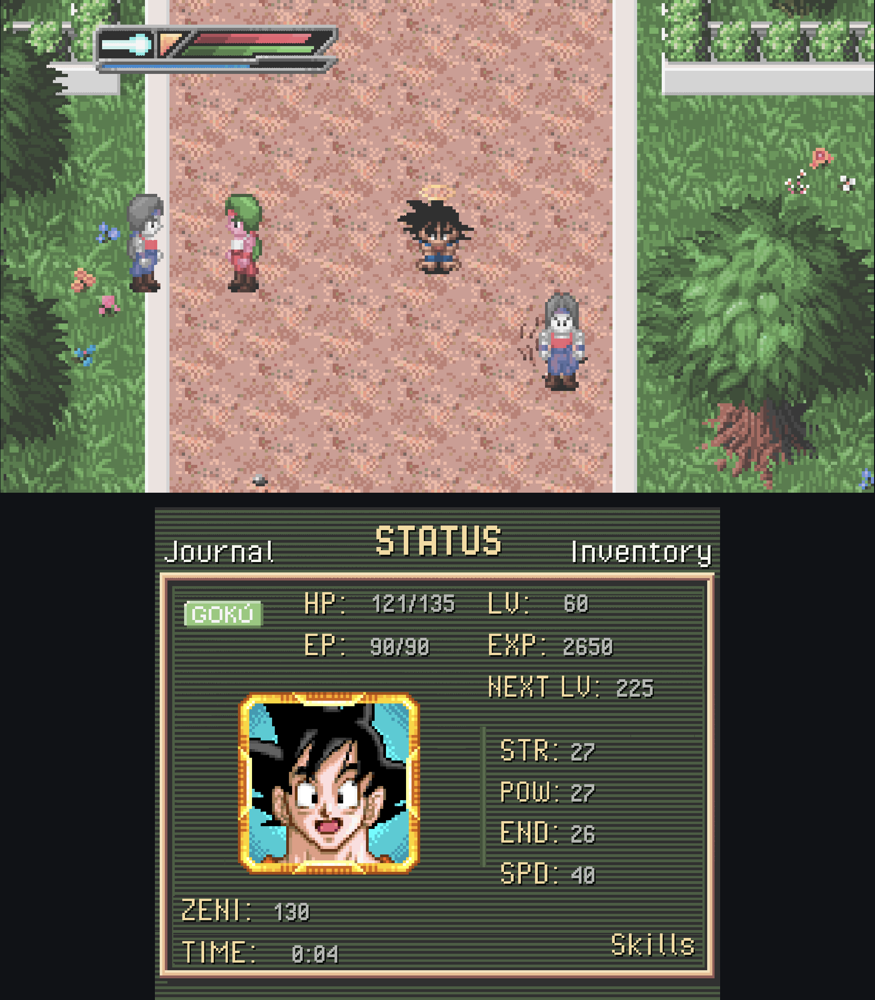
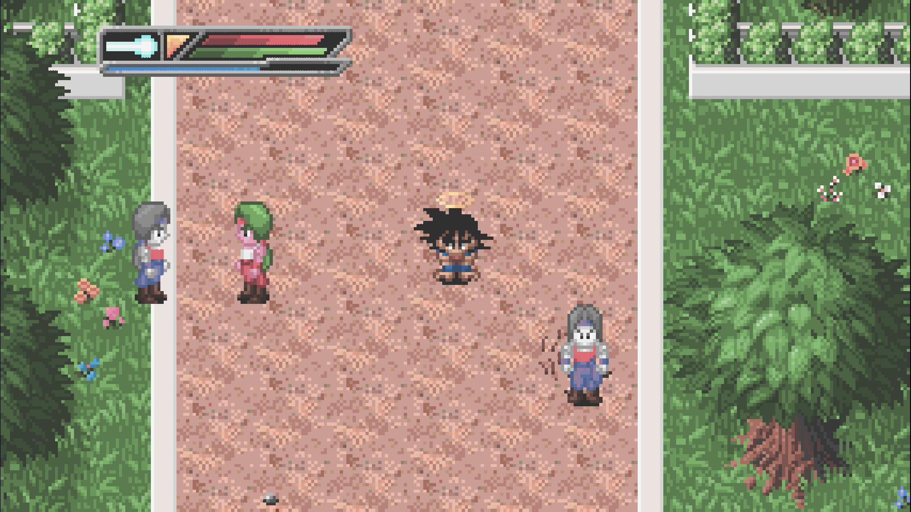
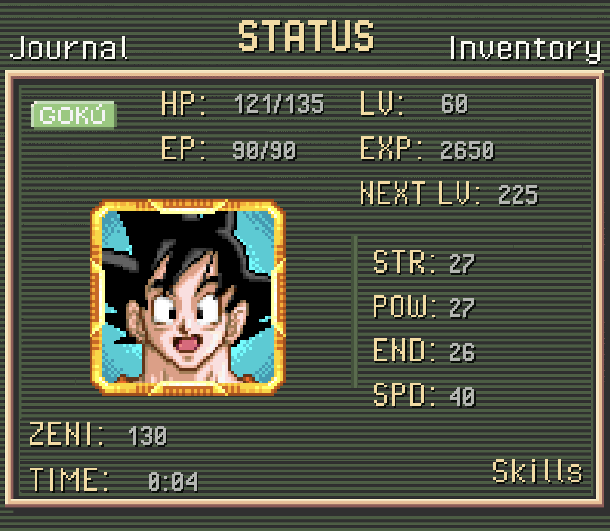
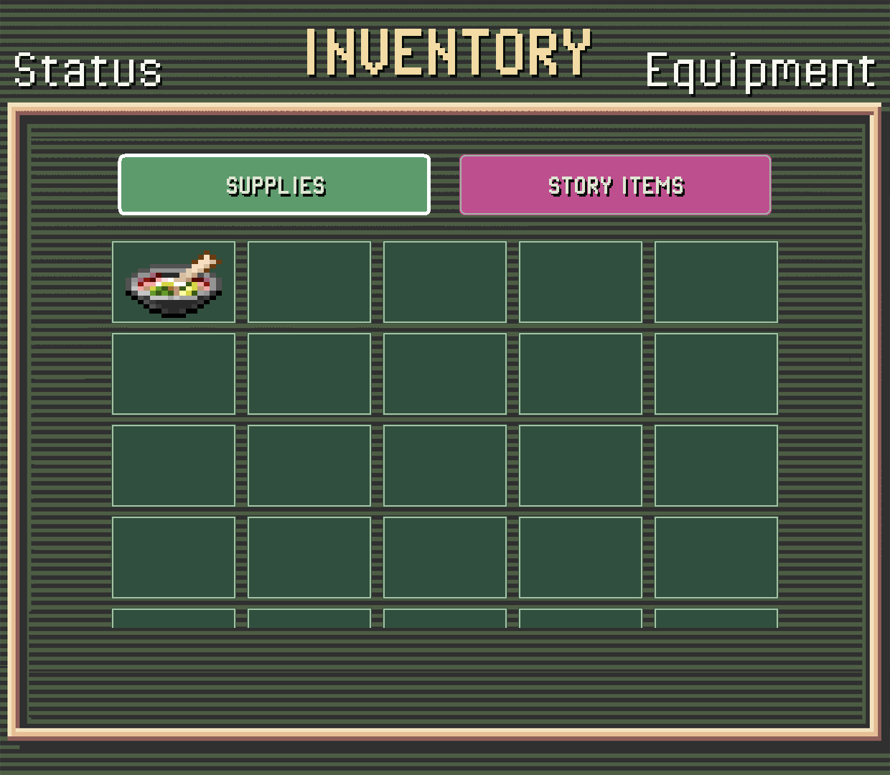
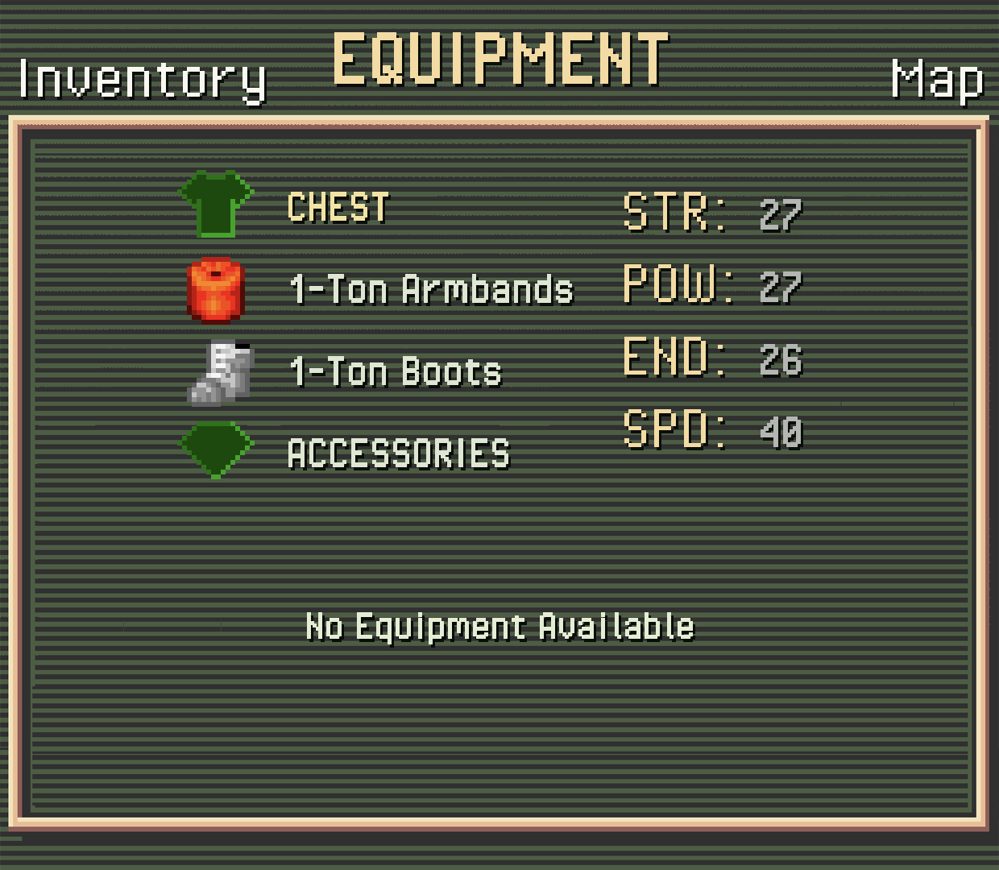
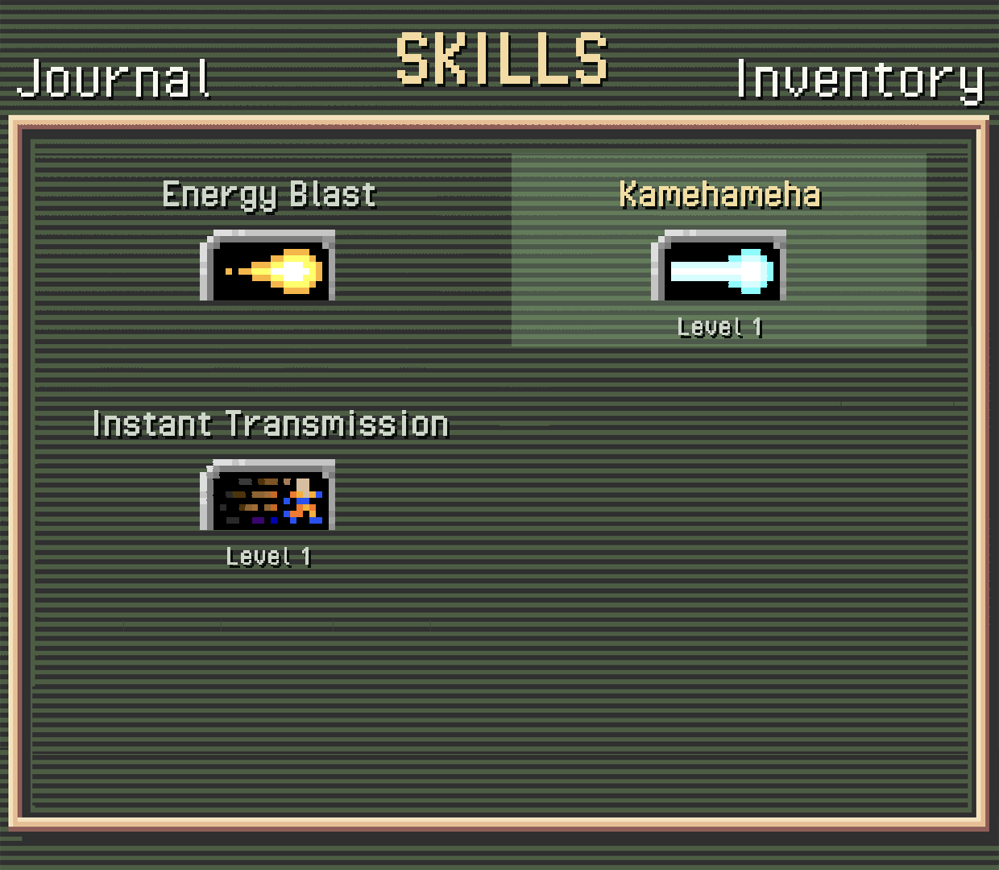
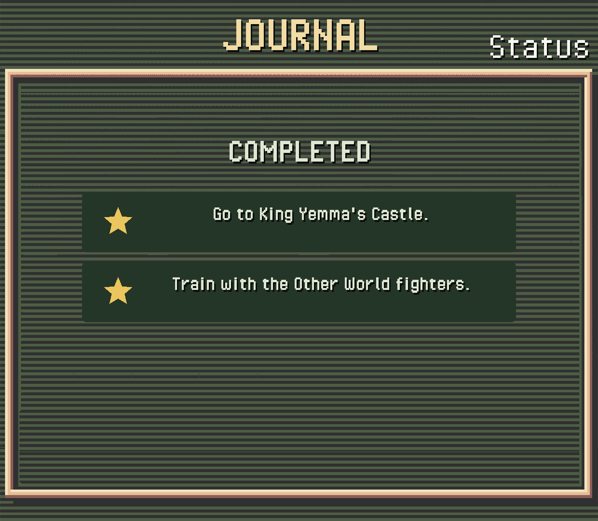
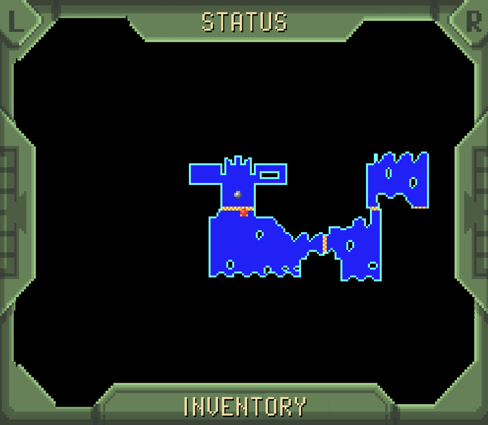

<div align="center">


# Dragon Ball Z: Buu's Fury — Android Dual-Screen

**Native Android ARM64 port with adaptive widescreen and a dedicated touchscreen companion interface for AYN Thor.**


</div>

## Overview

An unofficial Android adaptation of Dragon Ball Z: Buu's Fury for Game Boy Advance, based on the static recompilation projects developed by Matthew Stanley and NovaPowers.

Unlike conventional GBA emulation, the original game code is statically recompiled for native execution.

This Android adaptation introduces native dual-screen functionality, allowing gameplay on the upper display while a persistent touchscreen interface provides additional game information on the lower display.

## Dual-Screen Experience



The AYN Thor Max has been physically tested with the game running on its upper display and the companion interface on its lower display.

### Widescreen Gameplay



Adaptive widescreen reveals additional game-world content without simply stretching the original GBA image.

### Touchscreen Companion Interface

The secondary display provides six dedicated sections:

| Character Status | Inventory |
|---|---|
|  |  |
| Equipment | Skills |
|  |  |
| Journal | Map |
|  |  |

All screenshots were captured from the real Android application running on an AYN Thor.

## Features

- Native Android ARM64 integration using GBARecomp.
- Real dual-screen support through Android Presentation.
- Adaptive widescreen gameplay.
- Persistent touchscreen companion interface.
- Live character statistics and inventory information.
- Equipment and skill information.
- Quest journal.
- Scouter-inspired map interface.
- Automatic English and Spanish interface localization based on ROM identity.
- Integrated ROM and GBA BIOS importer.
- Physical gamepad support.
- Android-specific runtime and display handling.

This is an experimental project. Some features and gameplay interactions are still undergoing testing and refinement.

## Supported ROMs

Only specifically reviewed ROM identities are accepted.

| ROM | Language | Size |
|---|---|---|
| USA GoodTools / RetroAchievements | English | 8,388,608 bytes |
| USA No-Intro | English | 8,388,608 bytes |
| Reviewed Spanish translation | Spanish | 10,514,228 bytes |

### Supported SHA-1 Hashes

**USA GoodTools / RetroAchievements**

`f1c4b07554d2a3b1ad2f325307051e775ce68087`

**USA No-Intro**

`e65738e9d67688309f09811a54f495523ec9aada`

**Spanish translation**

`ee667f656f6c3a128b9d59c657b3686e58b23eb5`

The installer verifies the exact ROM hash and file size. Unknown or modified ROMs are rejected.

Recognition does not imply that every variant has been verified through a complete playthrough.

## GBA BIOS

An authentic 16 KiB Game Boy Advance BIOS is required.

Required SHA-1:

`300c20df6731a33952ded8c436f7f186d25d3492`

ROMs and BIOS files are not included.

## Languages

The lower-screen interface automatically follows the recognized ROM language.

- English: supported USA cartridges.
- Spanish: reviewed Spanish translation.
- French and Brazilian Portuguese: interface catalogs exist, but corresponding ROMs have not been admitted for execution.

There is no manual language selector. The selected cartridge determines the original game's language.

## Installation

Once a public APK release becomes available:

1. Download the Android APK from GitHub Releases.
2. Install the APK on your compatible Android device.
3. Launch the application.
4. Select and import your own supported Buu's Fury ROM.
5. Import your authentic GBA BIOS.
6. Allow the installer to validate both files.
7. Start the game.

The installer validates ROM identity before accepting an import. Failed ROM validation preserves the previously installed ROM.

Back up your save files before switching ROM variants.

## Building from Source

### Requirements

- Linux development environment
- Java 17
- Android SDK 35
- Android NDK 27.1.12297006
- Gradle 8.7
- Android Gradle Plugin 8.6.1
- CMake and Ninja
- User-supplied, hash-verified ROM and GBA BIOS
- Locally generated recompilation and BIOS dispatch sources

### Clone

```bash
git clone --recurse-submodules https://github.com/erpiopio/BuusFury-Thor.git
cd BuusFury-Thor
```

### Build

After preparing the required generated sources from your own ROM and BIOS:

```bash
./android/build.sh
```

Development APK output:

`android/app/build/outputs/apk/debug/app-debug.apk`

A clean checkout intentionally excludes copyrighted ROM-derived generated code, original game assets and BIOS material.

See [Android development documentation](docs/android-thor.md) for additional build configuration and runtime details. Some historical sections describe early development stages and may not reflect the latest tested implementation.

## ☕ Support the Project

If you enjoy **Buu's Fury Thor** and want to support the development of **Dragon Ball Z: Legacy Trilogy**, you can buy me a coffee!

[☕ **Buy Me a Coffee — Support erpiopio**](https://buymeacoffee.com/erpiopio)

Your support helps me continue working on the upcoming **Legacy of Goku II** and **Legacy of Goku I** Android adaptations.

Donations are completely optional. Thank you for your support! 🐉

## Credits

This project would not exist without the work of the original developers.

- **Matthew Stanley (mstan):** Original project, GBARecomp and static recompilation technology.
- **NovaPowers:** Buu's Fury Recomp fork, compatibility improvements, widescreen support and runtime development.
- **R.A.I.D. — Retro AI Development:** Static recompilation community.
- **erpiopio:** Android ARM64 adaptation, AYN Thor dual-screen integration, touchscreen companion interface and related runtime modifications.

### Original Projects

- [NovaPowers — Dragon Ball Z: Buu's Fury Recomp](https://github.com/novapowers0/DragonBallZBuusFuryRecomp)
- [Matthew Stanley — GBARecomp](https://github.com/mstan/gbarecomp)
- [AYN Thor GBARecomp Fork](https://github.com/erpiopio/gbarecomp-thor)

The original project's README is preserved in [Upstream Documentation](docs/README-upstream.md).

## License

The Buu's Fury Recomp project and GBARecomp-derived components are distributed under the PolyForm Noncommercial License 1.0.0.

Recomp UI is licensed under the MIT License.

Original copyright and attribution notices are retained.

See [LICENSE](LICENSE) for the applicable terms.

## Legal Disclaimer

This is an unofficial, non-commercial fan development and preservation project.

It is not affiliated with Nintendo, Atari, Webfoot Technologies, Toei Animation, Shueisha or any Dragon Ball rights holder.

Dragon Ball Z, Buu's Fury and all associated characters, artwork, audio and original game data belong to their respective owners.

No original game ROM, GBA BIOS or ROM-derived generated code is provided by this repository. Users must supply their own legally obtained files.

Compiled public releases must be reviewed to ensure that unauthorized copyrighted game assets are not included.
